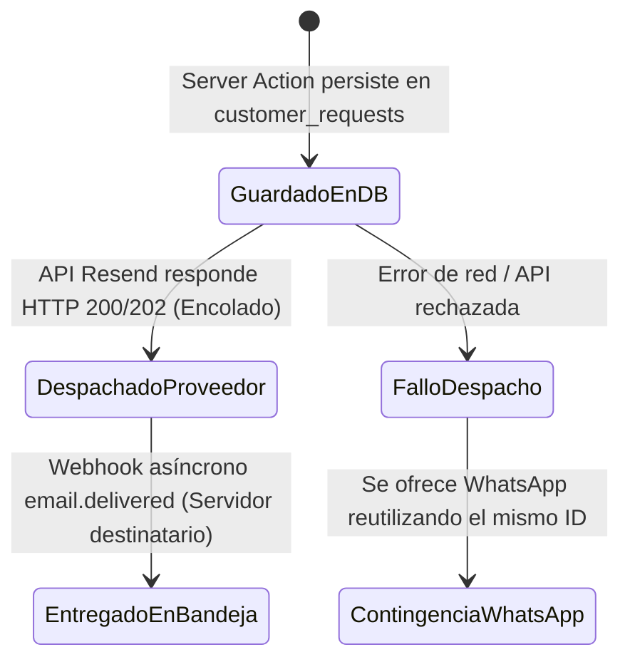

# Plan Técnico de Implementación (Plan): Catálogo Digital y Cotizaciones

## Referencia
* **Spec ID:** `SPEC-20261011-catalogo-cotizaciones`
* **Plan ID:** `PLAN-20261011-catalogo-cotizaciones`
* **Estado:** `REVIEW_COMPLETED` (Revisión Final de Seguridad y Preparación Realizada)

---

## 1. Resumen Arquitectónico de la Solución

La solución se estructura bajo una arquitectura desacoplada en Next.js App Router (Server Components + Server Actions) con validación estricta en servidor, políticas RLS robustas en Supabase y persistencia ligera del lado del cliente para la lista de cotización:

```mermaid
flowchart TD
    subgraph Cliente [Navegador / Cliente]
        Cat[Catálogo /productos] --> Ficha[Ficha /productos/slug]
        Ficha --> Store[Store Cotización en localStorage]
        Store --> Drawer[QuoteDrawer & /cotizar]
        Drawer --> Form[Formulario de Contacto]
    end

    subgraph Servidor Nextjs [Servidor Next.js (Server Action)]
        Form --> Action[submitQuoteRequest]
        Action --> ValZod[Validación Zod + Honeypot + Rate Limit]
        ValZod --> Decision{¿Canal elegido?}
        Decision -->|Email| EmailFlow[Despacho Correo Transaccional]
        Decision -->|WhatsApp| WAUrl[Generador de URL wa.me]
    end

    subgraph Base de Datos [Supabase PostgreSQL]
        ValZod --> DBInsert[(customer_requests)]
        DBInsert -.-> RLSCheck{Políticas RLS Restringidas}
    end

    EmailFlow --> TallerEmail[Bandeja de Correo del Taller]
    WAUrl --> ClientWA[Apertura WhatsApp con Mensaje Prellenado]
```

---

## 2. Auditoría de Seguridad de Supabase, Arquitectura de Inserción y Protección contra Abuso

### 2.1. Evaluación Crítica: Inserción Directa con Rol `anon` vs. Server Action con Credencial Exclusiva de Servidor

Se compararon dos modelos arquitectónicos para el registro de solicitudes de cotización:

| Dimensión Técnica | Alternativa A: Inserción Directa `anon` vía RLS | Alternativa B: Server Action en Node.js + Cliente de Servidor Restringido (Recomendada) |
| :--- | :--- | :--- |
| **Punto de Entrada** | Navegador interactúa directamente con API REST de Supabase usando `NEXT_PUBLIC_SUPABASE_ANON_KEY`. | Navegador invoca Server Action `submitQuoteRequest` en Next.js (Node.js runtime). |
| **Superficie de Exposición** | Expuesta: cualquier persona con la URL del proyecto y la anon key puede enviar peticiones directamente vía cURL. | Cerrada: la tabla `customer_requests` no permite inserción pública al rol `anon`. |
| **Validación de Cargas JSONB** | Ineficiente y frágil: RLS en PostgreSQL no puede validar de forma óptima el esquema interno, sanitización ni límites de tamaño en `contact_info` e `items_snapshot`. | Exhaustiva: Validación en servidor con Zod, verificando tipos, longitud de textos, cantidades, campos requeridos y estructura exacta. |
| **Control de Productos Activos** | Complejo y costoso en expresiones RLS: verificar que cada ID en un arreglo JSONB exista en `products` con `status = 'active'`. | Sencillo y seguro: Consulta previa en servidor a `products` verificando existencia y estado activo antes de persistir. |
| **Mitigación de Spam / Bots** | Imposible: RLS no evalúa honeypots de formulario ni tokens de verificación. | Robusta: Honeypot invisible descartado silenciosamente en servidor antes de tocar la base de datos. |
| **Límite de Frecuencia (Rate Limit)** | No existe control nativo granular por IP/sesión en las políticas RLS. | Centralizado en servidor mediante control de peticiones por IP/sesión. |

> **Decisión Arquitectónica Adoptada:** Se selecciona la **Alternativa B**. La tabla `customer_requests` **NO concede permisos de inserción al rol público `anon`**. Las inserciones se ejecutan exclusivamente a través del Server Action en Node.js mediante un cliente administrativo de servidor debidamente restringido (`createAdminClient()`).

### 2.2. Aislamiento y Uso Restringido de la Clave Privilegiada del Servidor
Para garantizar que el uso de `SUPABASE_SERVICE_ROLE_KEY` sea seguro y libre de riesgos:
1. **Restricción de Entorno:** La clave vive exclusivamente en variables de entorno del servidor (`.env.local` y Vercel Project Settings) **sin prefijo `NEXT_PUBLIC_`**. Los bundlers de Next.js jamás la incorporan en los paquetes JavaScript del cliente.
2. **Encapsulamiento Server-Only:** Se aísla en `lib/supabase/admin.ts` con la directiva `"server-only"`. Si algún componente del cliente intenta importarlo por error, la compilación de Next.js fallará inmediatamente.
3. **Ámbito de Operación Estrictamente Delimitado:** El cliente administrativo solo se utiliza para:
   - Insertar la solicitud ya validada en `customer_requests` con `status = 'pending'::request_status_type`.
   - Si el usuario es un invitado, se fuerza `customer_id = NULL`. Si el usuario está autenticado en la sesión (`supabase.auth.getUser()`), se asocia su propio ID. Queda técnicamente impedida la suplantación de identidad.

### 2.3. Controles Verificables de Validación y Protección contra Abuso
Antes de invocar el cliente de base de datos, el Server Action ejecuta las siguientes verificaciones:
1. **Límites de Longitud y Tamaño:**
   - Nombre: 2 a 100 caracteres (alfanumérico y espacios).
   - Teléfono: 8 a 20 caracteres (formato telefónico válido).
   - Correo electrónico: máximo 100 caracteres, formato RFC 5322 estricto.
   - Comuna / Ciudad: 2 a 100 caracteres.
   - Observaciones generales: máximo 500 caracteres.
   - Notas de personalización por ítem: máximo 200 caracteres.
   - Límite de carga útil total: máximo 20 KB (`contact_info` < 2 KB, `items_snapshot` < 15 KB).
2. **Límites de Cantidades:**
   - Por producto: entero positivo entre 1 y 1.000 unidades.
   - Cantidad total acumulada de la cotización: suma <= 10.000 unidades.
   - Variedad de productos: entre 1 y 50 artículos distintos en la lista.
3. **Validación de Productos Activos en Base de Datos:**
   - Se extraen los `productId` del snapshot y se verifica en `public.products`:
     `SELECT id FROM public.products WHERE id = ANY($1) AND status = 'active'::product_status_type;`
   - Si algún producto fue archivado o eliminado, la solicitud se rechaza con un mensaje claro al cliente.
4. **Honeypot Invisible Anti-Bot:**
   - Campo oculto con CSS (`position: absolute; left: -9999px`) llamado `website_url`, con `tabIndex={-1}` y `aria-hidden="true"`.
   - Si el campo contiene algún valor al recibirse en el servidor, se aborta la ejecución de forma silenciosa retornando respuesta neutra sin escribir en la base de datos ni enviar correos.
5. **Control de Frecuencia (Rate Limiting) en Entornos Serverless:**
   - En arquitectura serverless multi-instancia (Vercel), el estado en memoria volátil de Node.js no se comparte entre funciones.
   - El control de frecuencia se apoya en la cabecera `x-forwarded-for` (obtenida de forma segura mediante `headers()` de Next.js) y se coordina mediante verificación de solicitudes recientes en la base de datos o almacenamiento compartido (máximo 3 envíos cada 10 minutos por IP/correo).
   - **Comportamiento ante Fallo del Mecanismo (Fail-Open Supervisado):** Si el servicio auxiliar de verificación de tasa experimenta una degradación de red, se aplica *fail-open supervisado* (se permite la solicitud si el honeypot y el esquema Zod son válidos, pero se registra una advertencia en los logs del servidor), evitando bloquear a clientes reales por fallas de telemetría.
6. **Prevención de Envíos Duplicados e Idempotencia:**
   - En el cliente: Botón de envío deshabilitado instantáneamente con indicador visual de carga (`loading`).
   - En el servidor: Se calcula un hash de idempotencia (`hash(email + items + timestamp_minute)`). Peticiones idénticas dentro de una ventana de 15 segundos retornan el resultado de la solicitud ya registrada sin crear una nueva fila.
7. **Saneamiento Severo de Textos:**
   - Todos los campos de texto se normalizan en el servidor: eliminación de etiquetas HTML/scripts, recorte de espacios en blanco (`trim`) y escape de caracteres para prevenir ataques XSS almacenados en el panel del taller o inyecciones en clientes de correo.

---

## 3. Compatibilidad con el Esquema Real y Estrategia de Recuperación No Destructiva

### 3.1. Auditoría del Esquema Real de Base de Datos
Inspeccionado en las migraciones existentes del repositorio:
* **Tabla `customer_requests`** (`20260718000200_customer_quotation_engine.sql`):
  - `id UUID PRIMARY KEY DEFAULT gen_random_uuid()`
  - `customer_id UUID REFERENCES public.profiles(id) ON DELETE CASCADE NOT NULL` (Restricción que actualmente impide cotizaciones de invitados).
  - `description TEXT NOT NULL`
  - `target_product_id UUID REFERENCES public.products(id) ON DELETE SET NULL`
  - `requested_quantity INTEGER DEFAULT 1 NOT NULL`
  - `origin_channel VARCHAR(50) NOT NULL` (Valores permitidos en aplicación: `'Web'`, `'WhatsApp'`, `'Email'`).
  - `status request_status_type DEFAULT 'pending'::request_status_type NOT NULL`
    * Tipo enum `request_status_type`: valores válidos exactos `'pending'`, `'reviewed'`, `'responded'`, `'closed'`.
  - Disparador: `trigger_update_requests_timestamp` actualiza `updated_at`.
* **Función `public.is_admin()`** (`20260718000000_core_system_foundation.sql`):
  - Verifica si `auth.uid()` existe en `public.profiles` con `role = 'admin'::user_role_type`. Devuelve `FALSE` para usuarios anónimos y roles `customer`, `sales`, `designer` o `production`.
* **Políticas RLS Existentes en `customer_requests`:**
  - `"Users can view and create their own requests"`: `FOR ALL USING (auth.uid() = customer_id)`.
  - `"Admins and Sales can manage all requests"`: `FOR ALL USING (public.is_admin())`.

### 3.2. Script de Migración Propuesto (Up Migration)
```sql
-- supabase/migrations/20261012000000_guest_quotation_support.sql

-- 1. Permitir customer_id NULL para admitir cotizaciones de invitados sin romper la clave foránea
ALTER TABLE public.customer_requests ALTER COLUMN customer_id DROP NOT NULL;

-- 2. Incorporar datos de contacto estructurados
ALTER TABLE public.customer_requests ADD COLUMN IF NOT EXISTS contact_info JSONB DEFAULT '{}'::jsonb NOT NULL;

-- 3. Incorporar snapshot de productos cotizados
ALTER TABLE public.customer_requests ADD COLUMN IF NOT EXISTS items_snapshot JSONB DEFAULT '[]'::jsonb NOT NULL;

-- 4. Reemplazar la política integral de usuarios para restringir el acceso del cliente
-- Se retira la política que permitía INSERT directo al rol autenticado, canalizando todas las creaciones
-- a través del Server Action seguro, y garantizando que el rol anon no tenga ningún acceso directo.
DROP POLICY IF EXISTS "Users can view and create their own requests" ON public.customer_requests;
DROP POLICY IF EXISTS "Users can view own requests" ON public.customer_requests;

-- 4a. Política de lectura exclusiva para usuarios autenticados respecto a sus propias solicitudes:
CREATE POLICY "Users can view own requests"
ON public.customer_requests FOR SELECT
USING (
  auth.uid() IS NOT NULL AND auth.uid() = customer_id
);

-- Nota: El rol 'anon' NO tiene concedida ninguna política (SELECT, INSERT, UPDATE, DELETE quedan denegados).
-- Los administradores conservan acceso total mediante "Admins and Sales can manage all requests" (FOR ALL USING is_admin()).
```

### 3.3. Estrategia de Recuperación No Destructiva (Rollback y Preservación de Datos)

> **REGLA DE ORO DE RECUPERACIÓN:** Un script de reversión de producción **NUNCA DEBE EJECUTAR `DROP COLUMN`** sobre columnas que contienen datos de clientes reales (`contact_info` e `items_snapshot`). Hacerlo causaría una pérdida irreversible de información comercial.

1. **Diferenciación entre Reversión de Esquema y Recuperación de Datos:**
   - **Reversión de Esquema:** Ajustar políticas de seguridad y restricciones para restablecer el comportamiento anterior de la aplicación.
   - **Recuperación de Datos:** Mantener la integridad de los registros creados durante el tiempo que la funcionalidad estuvo en operación.
2. **Tratamiento de `customer_id` NULL:**
   - Restaurar `ALTER TABLE customer_requests ALTER COLUMN customer_id SET NOT NULL;` **fallará de inmediato** si existen solicitudes creadas por invitados con `customer_id IS NULL`.
   - En una reversión, la columna `customer_id` **debe permanecer como nullable** a nivel de base de datos para no tener que eliminar solicitudes de clientes reales.
   - Si por una necesidad regulatoria o de sistema legado fuera estrictamente obligatorio restaurar `NOT NULL`, se debe ejecutar previamente una migración de datos asignando esas filas a un perfil de sistema especial (ej. `00000000-0000-0000-0000-000000000000` correspondiente a "Invitados Web"), **nunca eliminando las filas**.
3. **Script de Reversión No Destructiva:**
```sql
-- Script de reversión seguro (NO destructivo):

-- 1. Restaurar política original para usuarios registrados
DROP POLICY IF EXISTS "Users can view own requests" ON public.customer_requests;

CREATE POLICY "Users can view and create their own requests" 
ON public.customer_requests FOR ALL 
USING (auth.uid() = customer_id);

-- 2. PRESERVACIÓN DE COLUMNAS:
-- NO se ejecutan DROP COLUMN sobre contact_info ni items_snapshot.
-- El código anterior simplemente ignorará estas columnas sin generar errores.

-- 3. PRESERVACIÓN DE REGISTROS:
-- NO se ejecuta SET NOT NULL forzado en customer_id para evitar fallos de integridad y preservar las cotizaciones recibidas.
```
4. **Identificación de Cambios No Reversibles sin Copia de Seguridad:**
   - La eliminación de columnas (`DROP COLUMN`) o el borrado de filas huérfanas (`DELETE WHERE customer_id IS NULL`) son **irreversibles** sin un backup formal o restauración Point-In-Time (PITR) de Supabase.

---

## 4. Flujo Detallado de Correo y WhatsApp: Estados Reales y Contingencia

### 4.1. Diferenciación de los Tres Estados Reales del Correo
Para garantizar transparencia y rigor técnico, el sistema reconoce tres estados distintos en el flujo de correo:



1. **Estado 1: Guardado en Base de Datos (`saved_in_db`):**
   - La solicitud se almacena en `customer_requests` con `status = 'pending'`, obteniendo su identificador único (ej. `SOL-A8F3`).
2. **Estado 2: Aceptado por el Proveedor de Correo (`dispatched_to_provider`):**
   - El proveedor transaccional (ej. Resend) recibe la petición HTTP y devuelve un identificador de mensaje (`msg_resend_12345`). Esto significa que el correo está **encolado para envío en los servidores del proveedor**, pero **no constituye prueba de entrega en la bandeja de entrada**.
   - **Mensaje presentado al cliente en pantalla:**
     > *"¡Cotización registrada con éxito! (Ref: SOL-XXXX). Hemos enviado la notificación a nuestro taller y te responderemos a la brevedad."*
     *(Queda prohibido afirmar «Correo entregado en bandeja» basándose únicamente en la respuesta HTTP 200).*
3. **Estado 3: Entrega Confirmada en Destino (`email_delivered`):**
   - Este evento solo puede confirmarse de forma asíncrona mediante un webhook (`email.delivered`). No se evalúa en el ciclo sincrónico de la interfaz web.

### 4.2. Manejo de Fallos en Despacho y Contingencia sin Duplicación
Si la llamada al servicio de correo falla tras haber registrado la solicitud en Supabase:
1. **La solicitud ya está resguardada:** No se pierde la cotización del cliente.
2. **Respuesta no técnica y transparente:**
   > *"Tu cotización quedó registrada en nuestro sistema con la referencia **SOL-XXXX**. Ocurrió una intermitencia momentánea enviando el correo al taller. Para asegurar una atención inmediata, puedes avisarnos directamente por WhatsApp con el siguiente botón."*
3. **Prevención de Duplicados en Contingencia:**
   - El botón de contingencia de WhatsApp **NO vuelve a insertar en `customer_requests`**.
   - Reutiliza directamente el identificador `SOL-XXXX` ya creado y los datos locales de la cotización para armar el mensaje:
     *«Hola Papelería y Creaciones E&G, registré la cotización SOL-XXXX en el sitio web para los siguientes productos: ...»*.
   - Se garantiza exactamente 1 registro en la base de datos.

### 4.3. Comportamiento del Canal WhatsApp
1. El cliente pulsa «Cotizar por WhatsApp».
2. El Server Action guarda la solicitud en Supabase con `origin_channel = 'WhatsApp'` y genera el identificador `SOL-XXXX`.
3. Se genera la URL oficial `https://wa.me/[NUMERO_EMPRESA]?text=[MENSAJE_ENCODED]` y se abre en una nueva pestaña.
4. **Mensaje informativo obligatorio en la pantalla del sitio web:**
   > *"Hemos abierto WhatsApp con tu cotización lista (Ref: SOL-XXXX). Por favor revisa el mensaje en tu aplicación y presiona **«Enviar»** para que nuestro equipo lo reciba."*
5. Se reconoce expresamente que la apertura del enlace no equivale a confirmación de entrega por parte del servidor de WhatsApp.

---

## 5. Estrategia y Pipeline de Fotografías

* **Ruta de origen (Intocable):** `C:\Users\Pyme\Desktop\Fotos Papeleria Y Creaciones E&G` (533 archivos). Cero modificaciones a los originales.
* **Selección objetivo:** 2 a 3 fotografías por producto (aprox. 60–70 imágenes en total para las 26 colecciones).
* **Destino de copias web:** `public/images/products/[categoria]/[producto]-[1|2|3].webp`.
* **Dimensiones:** Máximo 800×800 px proporcional, sin recorte forzado de bordes ni pérdida de detalles.
* **Peso y formato:** WebP calidad 85%, peso objetivo < 120 KB por archivo.
* **Archivos excluidos:** Los 2 archivos de video `.MOV` no se procesarán ni publicarán en esta fase.

---

## 6. Los Tres Controles Humanos Independientes

El proyecto no avanzará entre etapas sin las siguientes autorizaciones explícitas:

1. **Control Humano 1 (Aprobación de Fotografías):** El propietario debe revisar y aprobar la lista de fotografías seleccionadas (manifiesto) antes de ejecutar el script de procesamiento WebP.
2. **Control Humano 2 (Aprobación de Implementación):** El propietario debe autorizar expresamente el inicio de la Fase 1 tras revisar esta documentación.
3. **Control Humano 3 (Aprobación Independiente de Publicación):** Tras superar todos los Quality Gates locales (`typecheck`, `lint`, `test`, `build`), se requerirá una autorización formal e independiente antes de realizar cualquier commit o push a `main`.

---

## 7. Datos Pendientes que Debe Proporcionar el Propietario

1. **WhatsApp Empresarial:** Número de teléfono con código de país (ej. `569XXXXXXXX`).
2. **Correo Electrónico del Taller:** Dirección donde recibir las notificaciones de cotización.
3. **Proveedor de Correo Transaccional:** API Key de Resend (recomendado en Vercel) o credenciales SMTP del correo corporativo.
