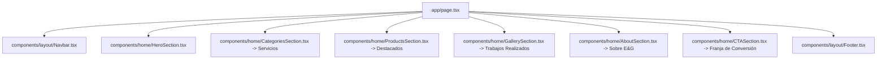

# Plan Técnico de Implementación (Plan)

## Referencia
* **Spec ID:** `SPEC-20261016-redisenio-homepage-fidelidad`
* **Plan ID:** `PLAN-20261016-redisenio-homepage-fidelidad`
* **Estado:** `APPROVED`

---

## 1. Arquitectura Técnica de Componentes

Se estructuran y refactorizan los siguientes módulos para la fidelidad total:

### Componentes y Roles
1. `Navbar.tsx`: Navbar sticky con fondo desenfocado, enlaces centrados con pestaña activa rosa, botón de WhatsApp estilo píldora.
2. `HeroSection.tsx`: Layout split 50/50 en desktop con H1 bicolor, botones de acción, fila de 3 micro-badges (Hecho con amor, Personalizados, Calidad premium) y asset `/images/banner.png` integrado a la derecha con fundido suave.
3. `CategoriesSection.tsx`: Título `✦ Nuestros servicios ✦`, grilla de 5 tarjetas en una fila (`grid-cols-1 sm:grid-cols-2 lg:grid-cols-5`).
4. `ProductsSection.tsx`: Título `✦ Productos destacados ✦` + botón lateral `Ver todos`, 5 tarjetas con fotografía de producto, nombre y precio en rosa.
5. `GallerySection.tsx`: Título `✦ Trabajos realizados ✦`, franja continua de 6 fotos de taller con esquinas redondeadas.
6. `AboutSection.tsx`: Sección de 2 columnas: izquierda con ilustración de taller, etiqueta `Sobre E&G`, titular serif, descripción y botón `Conoce nuestra historia`; derecha con 3 tarjetas apiladas de beneficios.
7. `CTASection.tsx`: Franja horizontal con gradiente suave lavanda/rosa y botón doble línea para WhatsApp.
8. `Footer.tsx`: 4 columnas semánticas, derechos reservados y botón flotante de retorno arriba.

---

## 2. Gestión de Estilos y Tipografía
* Clases Tailwind CSS v4 para espaciados, colores HSL/hex y transiciones.
* Incorporación de degradados y sombras pastel sutiles para emular la suavidad del diseño de referencia.
