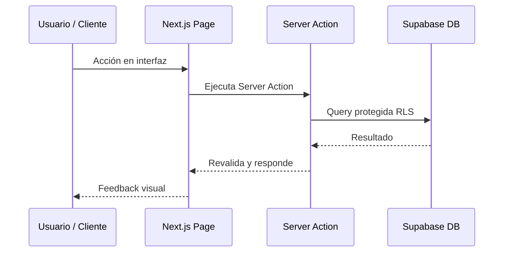

# Plan Técnico de Implementación (Technical Plan)

## Referencia
* **Spec ID:** `SPEC-[YYYYMMDD]-[slug]`
* **Plan ID:** `PLAN-[YYYYMMDD]-[slug]`
* **Estado:** `PROPOSED | APPROVED | IN PROGRESS | COMPLETED`

---

## 1. Resumen de la Solución Técnica
* Breve descripción de la arquitectura y el enfoque que se adoptará para implementar los requisitos de la especificación.

---

## 2. Análisis de Impacto en la Arquitectura Existente
* **Rutas afectadas (`app/`):** Listado de páginas o endpoints modificados o añadidos.
* **Componentes (`components/`):** Componentes nuevos o actualizados.
* **Lógica y Server Actions (`app/actions/`, `lib/`):** Funciones del servidor y utilidades.
* **Base de datos (`supabase/`):** Nuevas tablas, columnas, funciones o políticas RLS.
* **Estilos / Assets (`public/`, `globals.css`):** Nuevas clases, imágenes o variables.
* **Compatibilidad de Runtime:** Confirmar compatibilidad con el entorno de despliegue y runtime verificado.

---

## 3. Diseño Técnico Detallado

### 3.1. Modelo de Datos y Tipos TypeScript
```typescript
// Interfaces o tipos clave
export interface FeatureData {
  id: string;
  // ...
}
```

### 3.2. Flujo de Datos y Componentes


### 3.3. Manejo de Errores y Casos Borde
* ¿Qué ocurre si la red falla o Supabase devuelve error?
* ¿Cómo se gestionan estados de carga (`loading`), vacíos (`empty`) y error?

---

## 4. Plan de Pruebas y Verificación
* **Comandos de validación:**
  - `npm run typecheck`
  - `npm run lint`
  - `npm run test` (incluyendo nuevos tests asociados)
  - `npm run build`
* **Verificación funcional:** Pasos para comprobar manualmente en local y en producción en Vercel.

---

## 5. Estrategia de Rollback
* En caso de fallo en el despliegue o en producción, cómo se revierte el cambio de forma segura (sin `git push --force`).
